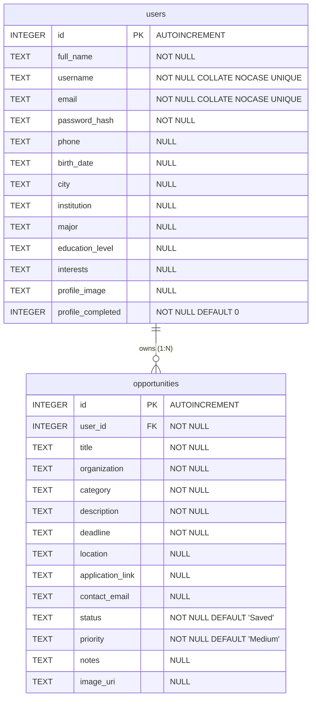

# Database Schema Documentation

This document describes the database design, table relationships, schemas, and validations for the Forsa Android application.

---

## 1. Database Overview

Forsa stores all its persistent data locally on the Android device. It uses **SQLite** through Android's built-in `SQLiteOpenHelper` framework.

- **Exact Database Name**: `forsa.db`
- **Exact Database Version**: `3`
- **Database Helper Class Path**: `app/src/main/java/com/example/forsa/database/DatabaseHelper.java`
- **Number of Tables**: `2`
- **Table Names**:
  1. `users` — Stores user account credentials, profile details, and settings.
  2. `opportunities` — Stores opportunities saved/tracked by users.

---

## 2. ER Relationship Diagram

The following entity-relationship diagram shows the exact database tables, column names, keys, and their one-to-many (1:N) relationship.



---

## 3. Relational Schema

Below is the database structure represented in Relational Schema format:

```text
USERS(
    id INTEGER PRIMARY KEY AUTOINCREMENT,
    full_name TEXT NOT NULL,
    username TEXT NOT NULL COLLATE NOCASE UNIQUE,
    email TEXT NOT NULL COLLATE NOCASE UNIQUE,
    password_hash TEXT NOT NULL,
    phone TEXT,
    birth_date TEXT,
    city TEXT,
    institution TEXT,
    major TEXT,
    education_level TEXT,
    interests TEXT,
    profile_image TEXT,
    profile_completed INTEGER NOT NULL DEFAULT 0
)

OPPORTUNITIES(
    id INTEGER PRIMARY KEY AUTOINCREMENT,
    user_id INTEGER NOT NULL FOREIGN KEY REFERENCES users(id) ON DELETE CASCADE,
    title TEXT NOT NULL,
    organization TEXT NOT NULL,
    category TEXT NOT NULL,
    description TEXT NOT NULL,
    deadline TEXT NOT NULL,
    location TEXT,
    application_link TEXT,
    contact_email TEXT,
    status TEXT NOT NULL DEFAULT 'Saved',
    priority TEXT NOT NULL DEFAULT 'Medium',
    notes TEXT,
    image_uri TEXT
)
```

---

## 4. Detailed Schema Tables

### Table: `users`

| Column Name | SQLite Type | Key / Constraint | Nullable | Description |
|---|---|---|---|---|
| `id` | `INTEGER` | `PRIMARY KEY AUTOINCREMENT` | **No** | Unique identifier for each user profile. |
| `full_name` | `TEXT` | `NOT NULL` | **No** | User's full name. |
| `username` | `TEXT` | `NOT NULL`, `COLLATE NOCASE UNIQUE` | **No** | Case-insensitive unique username for logins. |
| `email` | `TEXT` | `NOT NULL`, `COLLATE NOCASE UNIQUE` | **No** | Case-insensitive unique email for logins. |
| `password_hash` | `TEXT` | `NOT NULL` | **No** | Securely hashed password. |
| `phone` | `TEXT` | None | Yes | User's contact phone number (optional). |
| `birth_date` | `TEXT` | None | Yes | User's date of birth in `yyyy-MM-dd` text format. |
| `city` | `TEXT` | None | Yes | City where the user resides. |
| `institution` | `TEXT` | None | Yes | Name of educational university or college. |
| `major` | `TEXT` | None | Yes | Major or specialization fields. |
| `education_level`| `TEXT` | None | Yes | User's completed education level. |
| `interests` | `TEXT` | None | Yes | Comma-separated list of selected sectors or interests. |
| `profile_image` | `TEXT` | None | Yes | String URI pointing to the profile image file. |
| `profile_completed`| `INTEGER` | `NOT NULL DEFAULT 0` | **No** | Boolean flag (`0` or `1`) showing if setup has completed. |

### Table: `opportunities`

| Column Name | SQLite Type | Key / Constraint | Nullable | Description |
|---|---|---|---|---|
| `id` | `INTEGER` | `PRIMARY KEY AUTOINCREMENT` | **No** | Unique identifier for each opportunity item. |
| `user_id` | `INTEGER` | `FOREIGN KEY` (references `users(id)`), `NOT NULL` | **No** | Owner identifier linked to the user account. |
| `title` | `TEXT` | `NOT NULL` | **No** | Title of the opportunity (e.g., job/internship name). |
| `organization` | `TEXT` | `NOT NULL` | **No** | Organization offering the opportunity. |
| `category` | `TEXT` | `NOT NULL` | **No** | Sector category (e.g., Scholarship, Internship). |
| `description` | `TEXT` | `NOT NULL` | **No** | Detailed description text. |
| `deadline` | `TEXT` | `NOT NULL` | **No** | Target due date in `yyyy-MM-dd` format. |
| `location` | `TEXT` | None | Yes | Location of the opportunity (optional). |
| `application_link`| `TEXT` | None | Yes | External application URL string. |
| `contact_email` | `TEXT` | None | Yes | Contact email address for inquiries. |
| `status` | `TEXT` | `NOT NULL DEFAULT 'Saved'` | **No** | Current application tracking status (e.g., Saved, Applied). |
| `priority` | `TEXT` | `NOT NULL DEFAULT 'Medium'`| **No** | Tracking priority level (Low, Medium, High). |
| `notes` | `TEXT` | None | Yes | Custom user annotations or note text. |
| `image_uri` | `TEXT` | None | Yes | Optional image URI string associated with the opportunity. |

---

## 5. Exact CREATE TABLE Statements

The following queries represent the exact database creation DDL executed in `DatabaseHelper.java`:

### Create Users Table
```sql
CREATE TABLE users (
    id INTEGER PRIMARY KEY AUTOINCREMENT, 
    full_name TEXT NOT NULL, 
    username TEXT NOT NULL COLLATE NOCASE UNIQUE, 
    email TEXT NOT NULL COLLATE NOCASE UNIQUE, 
    password_hash TEXT NOT NULL, 
    phone TEXT, 
    birth_date TEXT, 
    city TEXT, 
    institution TEXT, 
    major TEXT, 
    education_level TEXT, 
    interests TEXT, 
    profile_image TEXT, 
    profile_completed INTEGER NOT NULL DEFAULT 0
);
```

### Create Opportunities Table
```sql
CREATE TABLE IF NOT EXISTS opportunities (
    id INTEGER PRIMARY KEY AUTOINCREMENT, 
    user_id INTEGER NOT NULL, 
    title TEXT NOT NULL, 
    organization TEXT NOT NULL, 
    category TEXT NOT NULL, 
    description TEXT NOT NULL, 
    deadline TEXT NOT NULL, 
    location TEXT, 
    application_link TEXT, 
    contact_email TEXT, 
    status TEXT NOT NULL DEFAULT 'Saved', 
    priority TEXT NOT NULL DEFAULT 'Medium', 
    notes TEXT, 
    image_uri TEXT, 
    FOREIGN KEY (user_id) REFERENCES users(id) ON DELETE CASCADE
);
```

---

## 6. Table Relationships

- **Connection**: Every opportunity is tied to its owning user profile through the `user_id` column.
- **Foreign Key Enforcement**: SQLite foreign keys are explicitly enabled inside `onConfigure()` via:
  ```java
  database.setForeignKeyConstraintsEnabled(true);
  ```
- **Cascade Deletion**: The `opportunities` table declares the foreign key with `ON DELETE CASCADE`. When a user account is deleted, SQLite automatically deletes all opportunities owned by that user.
- **User Isolation**: Data isolation between multiple users is handled in Java. Database queries (e.g. `getOpportunitiesForUser()`, `getOpportunityById()`, `updateOpportunity()`, `deleteOpportunity()`) pass the current authenticated user's ID to the query's `WHERE` clause:
  ```sql
  SELECT * FROM opportunities WHERE user_id = ? ORDER BY deadline ASC;
  ```
  This ensures users cannot access, update, or delete opportunity items belonging to other profiles.

---

## 7. Application-Level Validations

The following validation checks are executed in Java at the application level before records are saved to SQLite. None of these rules are constraints enforced by the database engine itself.

| Validation Check | Target Field | Validation Rule | Java Class |
|---|---|---|---|
| **Full Name Format** | Full Name | Required, minimum 3 chars, can only contain letters, spaces, dots, and hyphens. | `RegisterActivity` |
| **Username Format** | Username | Required, 3–20 characters, alphanumeric and underscores only. | `RegisterActivity` |
| **Email Format** | Email | Required, matches standard regex pattern `Patterns.EMAIL_ADDRESS`. | `RegisterActivity`, `AddOpportunityActivity`, `EditOpportunityActivity` |
| **Email Match** | Confirm Email | Must exactly match the primary Email field. | `RegisterActivity` |
| **Password Strength** | Password | Required, minimum 8 characters, must contain at least one uppercase letter, one lowercase letter, and one number. | `RegisterActivity`, `CompleteProfileActivity` (Change Pass Dialog) |
| **Password Match** | Confirm Password | Must exactly match the password field. | `RegisterActivity`, `CompleteProfileActivity` (Change Pass Dialog) |
| **Username Uniqueness** | Username | Checks SQLite using `usernameExists()` to confirm username is not already taken. | `RegisterActivity` |
| **Email Uniqueness** | Email | Checks SQLite using `emailExists()` to confirm email is not already registered. | `RegisterActivity` |
| **Phone Number Format**| Phone | If provided, must match pattern `\+?[0-9]{7,15}`. | `CompleteProfileActivity` |
| **Minimum Age** | Birth Date | Required, user must be at least 15 years old. | `CompleteProfileActivity` |
| **City Format** | City | Required, 2–50 characters, letters/spaces only. | `CompleteProfileActivity` |
| **Institution/Major** | Institution, Major | Required, minimum 2 characters. | `CompleteProfileActivity` |
| **Education Level** | Education Level | Spinner item must be selected (position must not be 0). | `CompleteProfileActivity` |
| **User Interests** | Interests | User must select at least one preferred opportunity checkbox. | `CompleteProfileActivity` |
| **Title/Organization** | Opportunity Title / Org | Required, Title >= 3 chars, Org >= 2 chars. | `AddOpportunityActivity`, `EditOpportunityActivity` |
| **Category Selection** | Category | Spinner selection must be valid (position must not be 0). | `AddOpportunityActivity`, `EditOpportunityActivity` |
| **Description Length** | Description | Required, minimum 10 characters. | `AddOpportunityActivity`, `EditOpportunityActivity` |
| **Deadline Selection** | Deadline | Required. When adding new, date picker limits selection to current or future dates. | `AddOpportunityActivity`, `EditOpportunityActivity` |
| **Location Length** | Location | If provided, must be at least 2 characters. | `AddOpportunityActivity`, `EditOpportunityActivity` |
| **Web Link Format** | App Link | If provided, must match standard web URL regex pattern `Patterns.WEB_URL`. | `AddOpportunityActivity`, `EditOpportunityActivity` |
| **Status Selection** | Status | Spinner selection must be valid (position must not be 0). | `AddOpportunityActivity`, `EditOpportunityActivity` |

---

## 8. Simple Schema Explanation for Presentation

> **Discussion Pitch (Student Presentation)**
> 
> "For our database design, we divided our information into two separate tables: **users** and **opportunities**. We did this to avoid repeating user information like names or emails for every single opportunity entry, which is known as database normalization. 
> 
> To connect these tables, we added a column called `user_id` inside our **opportunities** table. In database terms, `id` in the users table is the **Primary Key** because it uniquely identifies each user. The `user_id` in the opportunities table acts as a **Foreign Key** because it references the user's primary key. This sets up a one-to-many relationship, meaning one user can track many different opportunities, while each opportunity stays linked to the exact user who saved it. It also allows us to configure cascade deletes so that if a user deletes their account, SQLite automatically cleans up all their saved opportunities."

---

## 9. Accuracy Audit

- **Authoritative Database Source**: Verified columns and constraints against [DatabaseHelper.java](file:///c:/Users/pc/StudioProjects/Forsa/app/src/main/java/com/example/forsa/database/DatabaseHelper.java).
- **Invented Columns**: None. Checked that SQLite columns match the constants:
  - `users`: `id`, `full_name`, `username`, `email`, `password_hash`, `phone`, `birth_date`, `city`, `institution`, `major`, `education_level`, `interests`, `profile_image`, `profile_completed`.
  - `opportunities`: `id`, `user_id`, `title`, `organization`, `category`, `description`, `deadline`, `location`, `application_link`, `contact_email`, `status`, `priority`, `notes`, `image_uri`.
- **SQL Data Types**: Accurately mapped to SQLite types (`INTEGER` and `TEXT`).
- **Keys**: Verified Primary Keys, Unique fields, and Foreign Key referencing `users(id) ON DELETE CASCADE`.
- **Validation Check Mapping**: Carefully separated database SQL constraints (e.g. `NOT NULL`, `UNIQUE`) from Java code logic validations (e.g. length checks, matches, regex patterns).
